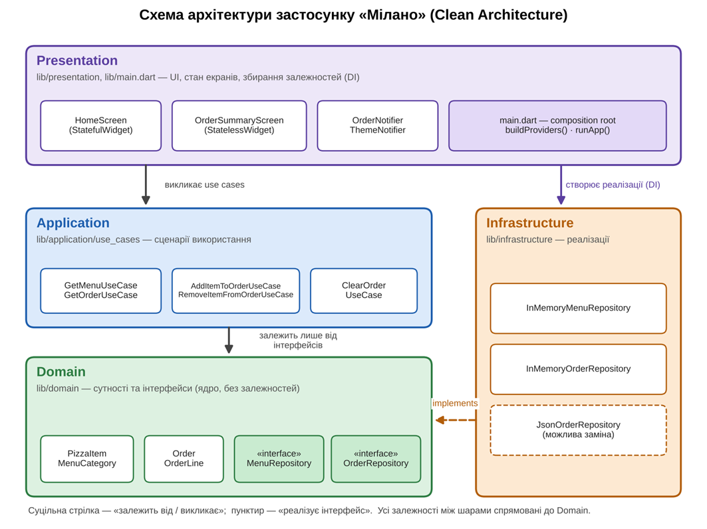

# Мілано — застосунок піцерії (Clean Architecture)
 
Flutter-застосунок для замовлення піци. Код розділено на шари:
Domain, Application, Infrastructure, Presentation.
 
## Архітектура
 

 
- **Domain** — сутності (`PizzaItem`, `Order`) та інтерфейси репозиторіїв.
- **Application** — use cases, які працюють лише через інтерфейси Domain.
- **Infrastructure** — реалізації репозиторіїв (InMemory).
- **Presentation** — екрани, Provider, точка входу з DI (`lib/main.dart`).
 
## Збірка та запуск
 
```bash
git clone https://github.com/<username>/milano-pizzeria.git
cd milano-pizzeria
flutter pub get
flutter test
flutter run -d chrome
```
 
## Гілки
 
`main` — стабільний код, `develop` — інтеграція, `feature/*` — задачі.